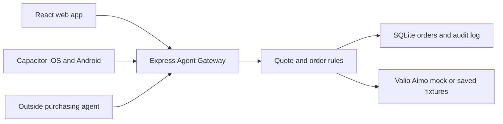

# Junction tech stack

Use one TypeScript monorepo. Build the chef and approver screens once in React and Vite. Package the same build for iOS and Android with Capacitor. Run the Agent Gateway and order workflow in one Node service on the Junction devbox.

| Layer | Choice | What it does |
| --- | --- | --- |
| Workspace | pnpm workspaces, TypeScript, Node 22 | One lockfile. Use `tsx watch` to run the API during development, `.tsx` for React components, and `tsc` for type checks and the server build. [pnpm workspaces](https://pnpm.io/workspaces/) · [tsx](https://github.com/privatenumber/tsx) · [Vite and TypeScript](https://vite.dev/guide/features.html#typescript) |
| Web and mobile | Vite, React, React Router, Capacitor | One responsive app for the request, quote, approvals, and order history. Vite builds `dist`. Capacitor copies it into the iOS and Android projects with `cap sync`. [Capacitor setup](https://capacitorjs.com/docs/getting-started) |
| API | Node.js, Express, Zod, OpenAPI 3.1 | The app and outside agents use the same gateway. Validate request bodies at runtime and publish the gateway contract at `/openapi.json`. |
| Data | SQLite on the devbox, SQL migrations | Import the local catalog and store hotel policies, quotes, decisions, orders, and audit events. One server owns the database; browser and mobile clients use HTTPS. [Node 22 SQLite](https://nodejs.org/docs/latest-v22.x/api/sqlite.html) |
| Error monitoring | Sentry | Use `@sentry/react` in the browser, `@sentry/capacitor` with the React SDK in the native app, and `@sentry/node` for Express. [Capacitor setup](https://docs.sentry.io/platforms/javascript/guides/capacitor/) · [Express setup](https://docs.sentry.io/platforms/javascript/guides/express/) |
| Feature flags and product analytics | PostHog | Roll out features by hotel, track how requests turn into orders, and run experiments on changes to the app. [Feature flags](https://posthog.com/docs/feature-flags) · [Product analytics](https://posthog.com/docs/product-analytics) · [Experiments](https://posthog.com/docs/experiments) |

## Repo layout

```text
apps/
  app/                 React, Vite, Capacitor config, ios/, android/
  api/                 Express, Aimo adapter, order rules, SQL migrations
packages/
  contracts/           Shared Zod schemas and TypeScript types
api/openapi.json        Existing upstream Valio Aimo spec
data/                   Existing catalog and fixture inputs
scripts/                Existing Python tools to fetch and inspect Aimo data
```

Use workspace imports for contracts. Keep hotel rules, database access, and provider clients in `apps/api` so every order path runs the same checks.

## How an order moves



1. The chef enters a list or describes a need in plain text. A server-side model can draft the same structured request. Show the parsed items and ask for missing details before quoting.
2. The gateway shortlists products from `data/products_slim.jsonl` and uses the Aimo mock for price and availability. It checks diet and allergen claims, whole packs, delivery date, cutoff, and the hotel's rules. Mark unknown stock and any fixture data on the quote.
3. A valid quote within the hotel's rules can become a simulated order. An exception appears on the approver's decisions list with the exact quote version. The approver answers using the card's buttons. When stock can't be confirmed, the person building the order is asked whether to continue, and can (D31). Hard blocks, such as an allergen conflict or a passed cutoff, stop the order.
4. Recheck price, stock, and cutoff before order commit. If terms change, issue a new quote and ask again when the rules require it. Use a database transaction and an idempotency key so that a retry returns the same order. Save the decision and rule IDs in the audit log.

Use seeded chef and approver accounts with server-issued sessions. Use an HTTP-only cookie on the web and a short-lived session token held in memory on mobile for the demo. Give the outside agent a separate scoped token. Resolve the hotel, site, and role from the credential on the server. The upstream Aimo mock only serves lookups. The Junction gateway owns quotes, simulated orders, and approvals. [Product rules](docs/prd-context.md) · [User stories](docs/user-stories.md)

## PostHog

- **Feature flags.** Use `posthog-js` in the shared React app and `posthog-node` in the gateway. Evaluate flags for API features on the server using the signed-in hotel. Optional features default to off when a flag result is unavailable. Hotel policy and approval rules apply under every flag value. [React SDK](https://posthog.com/docs/libraries/react) · [Node SDK](https://posthog.com/docs/libraries/node)
- **Product analytics.** Track request submission, quote creation, approval requests and decisions, and order placement. Send order and approval events from the gateway only when it records a new outcome, so a client retry counts once. Use these events to measure where requests drop off and how long approvals take. Send only the fields those metrics need, such as role, channel, and outcome. Keep request text, guest details, and order contents out of analytics. [Event capture](https://posthog.com/docs/product-analytics/capture-events)
- **Experiments and replay.** Use flag variants to test changes such as approval card wording. Use masked session replay to investigate friction in approved test sessions. Start with replay and autocapture off until the team has checked what they collect. [Experiments](https://posthog.com/docs/experiments) · [Replay privacy](https://posthog.com/docs/session-replay/privacy)

## Devbox and release flow

- **Web:** Run Vite and `tsx watch` with one root `pnpm dev` command. Use Vite's `/api` proxy for local work. Serve the demo build and gateway from one HTTPS origin on the T3 devbox. Seed one hotel and a fixed demo clock to make the order and cutoff cases repeatable.
- **Mobile:** Build the same app, run `cap sync`, and use Xcode or Android Studio for device builds. Point the app to the devbox's HTTPS API and allow the Capacitor origins in the API's CORS config. Start with one iOS smoke test of sign-in, quote, and approval. [Capacitor workflow](https://capacitorjs.com/docs/basics/workflow)
- **Sentry:** Tag errors with the environment and release commit. Upload source maps in CI so traces point to TypeScript lines. Keep provider keys and Sentry's upload token server-side or in CI. Scrub request bodies, credentials, and guest data from error reports. Start with errors and crashes. [Vite source maps](https://docs.sentry.io/platforms/javascript/guides/react/sourcemaps/uploading/vite/) · [Capacitor source maps](https://docs.sentry.io/platforms/javascript/guides/capacitor/sourcemaps/)
- **PostHog:** With a test project, verify one hotel flag in both states. Submit an order, retry with the same idempotency key, and check for one order placement event.
- **Secrets:** Use the existing private devbox `.env`. The base Git branch still tracks a file with that name, so make sure the app branch removes it from the index before adding local keys. Use a value-free `.env.example` to document variable names.

Verify three flows on the web first. Test a normal order, an order awaiting approval, and a blocked order. Then sync the mobile build and send a test error from each surface to Sentry. The existing Twilio and ElevenLabs setup is a separate dev integration. The current demo scope puts approvals in the app. [Demo scope](docs/prd-context.md#hard-constraints)
